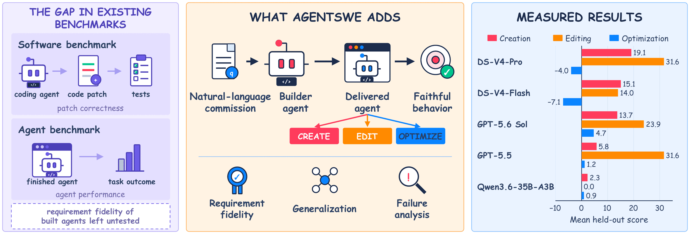
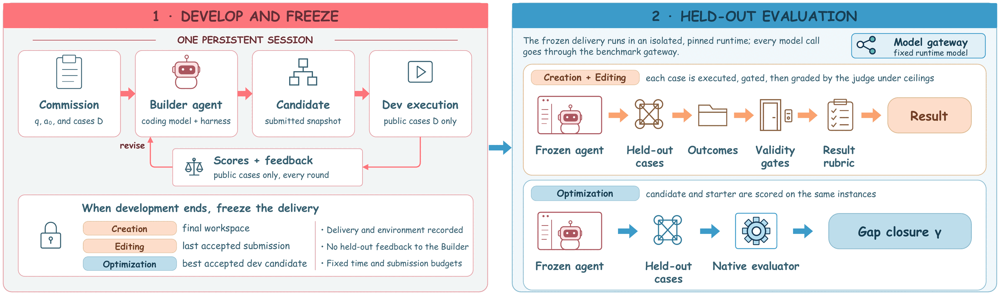

<h1 align="center">AgentSWE</h1>

<p align="center"><b>Can coding agents build the agent you actually want?</b></p>

<p align="center">
  <a href="https://vectorspacelab.github.io/AgentSWE"></a>
  <a href="https://arxiv.org/abs/2610.13361"></a>
  <a href="https://huggingface.co/papers/2610.13361"></a>
  <a href="LICENSE"></a>
</p>

<p align="center">
  <a href="#-news">News</a> |
  <a href="#-benchmark">Benchmark</a> |
  <a href="#-results">Results</a> |
  <a href="#agentswe-lite">Lite</a> |
  <a href="#-quick-start">Quick Start</a> |
  <a href="#-citation">Citation</a> |
  <a href="README_zh.md">Chinese</a>
</p>

AgentSWE is a benchmark for **agent software engineering**. A coding agent gets a natural-language commission for
an agent, builds or changes it, and the agent it delivers is tested on cases it never saw. The 25 tasks cover the
three stages of an agent's life: **Creation** (10), **Editing** (10) and **Optimization** (5).

<p align="center">
  
</p>

## ✨ Highlights

- **The whole lifecycle.** Build an agent from an empty directory, add capabilities to ten production agent
  codebases (Aider, OpenHands, Codex, DeepTutor and others), or improve a working agent on BrowseComp, τ³,
  Terminal-Bench, PinchBench and OSWorld.
- **A commission, not an exam.** The builder sees the requirement and a few example cases. Its frozen delivery is
  then run on held-out cases that cover the rest of the requirement, behind pass/fail gates and a rubric derived
  from the requirement. Optimization tasks use the source benchmark's own metric.
- **Today's coding agents fall short.** The 50 Creation runs average 11.2 out of 100 and 20 of them score zero.
  On Optimization, no builder closes more than 5% of the remaining gap on average.
- **Easy to try.** Every task runs in a pinned, isolated environment. The 8 Lite tasks need only a DeepSeek API key,
  so we recommend starting there.

## 🔥 News

- **2026-10**: The paper is on [arXiv](https://arxiv.org/abs/2610.13361) and [Hugging Face Papers](https://huggingface.co/papers/2610.13361).
- **2026-10**: Code, all 25 tasks and the Lite set are released.

## 📦 Benchmark

| Stage | The builder starts from | Tasks |
|---|---|---|
| Creation | an empty workspace | authorized vulnerability validation, database analytics, desktop GUI automation, document-to-editable PPTX, evidence-grounded document QA, formal theorem proving, repository bug repair, schema-guided web extraction, scientific PDF translation, web research report |
| Editing | a pinned production agent | AI-Scientist, Aider, Claude Code, Codex, DeepCode, DeepTutor, Dyad, OpenClaw, OpenHands, OpenWiki |
| Optimization | a working starter agent | BrowseComp, τ³ (retail), Terminal-Bench, PinchBench, OSWorld |

Each Creation and Editing task has 2 development cases and 6 held-out cases. Optimization tasks use disjoint
development and held-out subsets of the source benchmark.

<p align="center">
  
  <br>
  <em>The builder iterates on the public cases, then its frozen delivery is evaluated on held-out cases.</em>
</p>

## 📊 Results

Mean held-out score of five builders, all in the Codex harness. Creation and Editing report Result (0 to 100).
Optimization reports S, the gap closure: the share of the gap between the starter's held-out score J0 and the target
of 100 that the delivery's held-out score J closes, `S = 100 * min(1, (J - J0) / (100 - J0))`. S is negative when the
delivery scores below the starter, with no lower bound when the starter is already close to the target. Per-task
results are in the [paper](https://arxiv.org/abs/2610.13361) and on the [project page](https://vectorspacelab.github.io/AgentSWE).

| Builder | Creation | Editing | Optimization |
|---|---:|---:|---:|
| GPT-5.6 Sol | 13.7 | 23.9 | **4.7** |
| GPT-5.5 | 5.8 | **31.6** | 1.2 |
| DeepSeek-V4-Pro | **19.1** | **31.6** | -4.0 |
| DeepSeek-V4-Flash | 15.1 | 14.0 | -7.1 |
| Qwen3.6-35B-A3B | 2.3 | 0.0 | 0.9 |

What a builder shows during development is not what it delivers. The trajectories point to three recurring
failure modes: overfitting to the visible cases, hollow runtimes behind code that looks complete, and claims of
completion that the records contradict.

### AgentSWE-Lite

AgentSWE-Lite is 8 of the 25 tasks, built three times per builder in Codex, with DeepSeek-V4.1-Flash
(`deepseek-flash`) as the runtime model and the judge in all three stages (profile `lite-v1.1`). It needs only a
DeepSeek key, no search key and no release assets, so it is the easiest place to evaluate a new builder model.
Scores are the mean of the three builds. Because the runtime model and the judge differ from the main study, the
Creation and Optimization levels are not comparable with the table above.

| Stage | Task | GPT-5.6 Sol | DeepSeek-V4.1-Flash | Qwen3.6-35B-A3B |
|---|---|---:|---:|---:|
| Creation | Scientific PDF translation (`pdf`) | 18.9 | **31.9** | 0.0 |
| | Database analytics (`db`) | 7.4 | **38.7** | 0.0 |
| | Repository bug repair (`repo`) | **42.9** | 30.0 | 0.0 |
| Editing | DeepTutor adaptive remediation (`deeptutor`) | **52.2** | 27.6 | 0.0 |
| | Aider worktree transaction (`aider`) | 13.0 | **39.3** | 6.0 |
| | OpenWiki change-impact documentation (`openwiki`) | **22.8** | 21.0 | 0.0 |
| Optimization | τ³ (`tau3`) | 10.1 | **13.0** | 4.3 |
| | PinchBench (`pinch`) | 19.4 | **24.3** | 2.4 |
| **Mean** | Creation / Editing / Optimization | 23.1 / **29.3** / 14.8 | **33.5** / **29.3** / **18.7** | 0.0 / 2.0 / 3.4 |

## 🚀 Quick Start

You need Linux x86-64 with Docker and Python 3.10 or newer. Some tasks need more (KVM, cgroup v2 with systemd,
large disks); `doctor` tells you what a task needs and whether your host has it. `pip install -e .` adds an
`agentswe` command, the short form the docs use for `python3 -m agentswe`.

```bash
git clone https://github.com/VectorSpaceLab/AgentSWE.git && cd AgentSWE
cp .env.example .env                  # set AGENTSWE_DEFAULT_API_KEY to your DeepSeek key
python3 -m agentswe list              # the 25 tasks
python3 -m agentswe doctor repo       # host check, no model calls
python3 -m agentswe probe-roles       # one short request per model role with your key
python3 -m agentswe setup repo        # build the task environment (once)
python3 -m agentswe run repo --builder codex --smoke
python3 -m agentswe status
python3 -m agentswe result <run_id>
```

`--smoke` runs a small budget to check that everything works: one held-out case, after one development submission
for Creation and two for Editing. On a well-connected server the first setup and smoke run of `repo` take 25 to 45
minutes; an Editing smoke usually takes 10 minutes to about 2 hours, and up to about 8 hours (its builder's time cap)
when the builder is slow to make its two submissions. Without `--smoke` a run uses the paper's budgets, and its
result says whether it is comparable with the paper's numbers (`comparable` and `comparable_basis`; see
[profiles/README.md](profiles/README.md)). A full run takes as long as the builder works, up to its budget
(Creation 8 hours and 10 submissions, Editing 5 hours and 5 submissions, Optimization 16 hours and 5 development
rounds), plus the held-out evaluation: from under an hour to about a day.

The web research, PPTX and BrowseComp tasks also need a Serper-compatible search key. Behind a firewall or a proxy,
see [docs/ENV.md](docs/ENV.md).

### Run Lite (recommended)

The 8 Lite tasks are `repo`, `db`, `pdf` (Creation), `deeptutor`, `aider`, `openwiki` (Editing), `tau3`, `pinch`
(Optimization). With the Lite profile every role uses DeepSeek-V4.1-Flash (`deepseek-flash`), as in the Lite runs
above.

```bash
echo AGENTSWE_PROFILE=lite-v1.1 >> .env
python3 -m agentswe doctor repo db pdf deeptutor aider openwiki tau3 pinch
python3 -m agentswe probe-roles       # one short request per model role with your key
python3 -m agentswe setup <task>
python3 -m agentswe run <task> --builder codex --seed 1    # then --seed 2 and --seed 3
```

Run each task three times and report the mean of the three held-out results, as the Lite table above does; single
builds vary. `--seed` only names the run; each run is an independent build.

### Evaluate your own builder

The builder is a model in the Codex harness. Point the BUILDER role at your model with `AGENTSWE_BUILDER_BASE_URL`,
`AGENTSWE_BUILDER_API_KEY` and `AGENTSWE_BUILDER_MODEL`: any OpenAI-compatible endpoint works, with the Responses API
or, with `AGENTSWE_BUILDER_WIRE=chat`, Chat Completions. A model that Codex does not know also needs
`AGENTSWE_BUILDER_CONTEXT_WINDOW`. The Editing builder needs a Responses API endpoint (set
`AGENTSWE_EDITING_BUILDER_*` when it differs, then run `setup` again). The runtime model and the judge stay fixed,
so builders are compared on the same footing; see [docs/ENV.providers.md](docs/ENV.providers.md).

The held-out cases are part of this repository, so results can be reproduced and audited, and builders have network
access, as in the paper's runs. Report the builder's settings (model, effort, harness, network and search access)
with your scores.

In the Editing tasks the edited agent's model calls and the Result judge use the official DeepSeek API
(`https://api.deepseek.com`). These tasks also need cgroup v2 with systemd delegation (`doctor` checks it), and they
start system-scope systemd units: run every Editing command as root (or as a user allowed to start system units),
always as the same user, with `AGENTSWE_HOME` set in `.env`, and with Python 3.10 or newer at `/usr/bin/python3`
(see [docs/ENV.md](docs/ENV.md#editing-runs)). An Editing builder has 5 hours and up to 5 accepted submissions; when
its time runs out, `python3 -m agentswe freeze <run_id> --stage all --apply` evaluates its last accepted submission
(see [docs/ENV.md](docs/ENV.md#when-the-editing-builder-budget-ends)).

## 📚 Documentation

- [docs/ENV.md](docs/ENV.md): model roles, search keys, mirrors and proxies, Docker address pools
- [docs/ENV.providers.md](docs/ENV.providers.md): providers and models for each role
- [profiles/README.md](profiles/README.md): the `paper` and `lite-v1.1` configurations
- [docs/DESIGN.md](docs/DESIGN.md): task registry, runner interface, tests
- [THIRD_PARTY.md](THIRD_PARTY.md): upstream projects and their licenses

## 🙏 Acknowledgements

AgentSWE runs every task through [Harbor](https://github.com/harbor-framework/harbor) and adapts many open-source
agents and benchmarks; [THIRD_PARTY.md](THIRD_PARTY.md) lists them with their licenses.

## 📝 Citation

```bibtex
@misc{wang2026agentswe,
  title         = {AgentSWE: Can Coding Agents Build the Agent You Actually Want?},
  author        = {Jiahao Wang and Hongjin Qian and Yuyang Hu and Jiajun Zhang and Zheng Liu},
  year          = {2026},
  eprint        = {2610.13361},
  archivePrefix = {arXiv},
  primaryClass  = {cs.SE},
  url           = {https://arxiv.org/abs/2610.13361}
}
```

## License

Apache License 2.0; see [LICENSE](LICENSE) and [NOTICE](NOTICE). Upstream material keeps its own license: the
Optimization tasks include upstream benchmark data, two Editing tasks include reference patches to their targets, and
the release asset store hosts unmodified upstream files; [THIRD_PARTY.md](THIRD_PARTY.md) lists them with their
licenses. Editing targets and files that may not be redistributed are fetched from upstream during setup.
